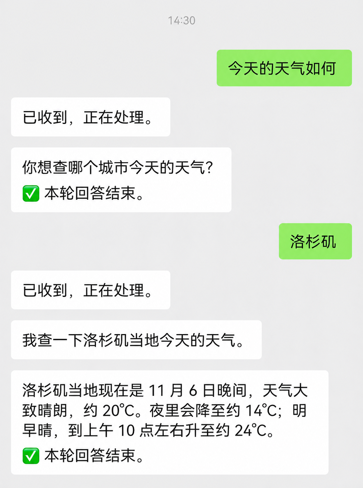
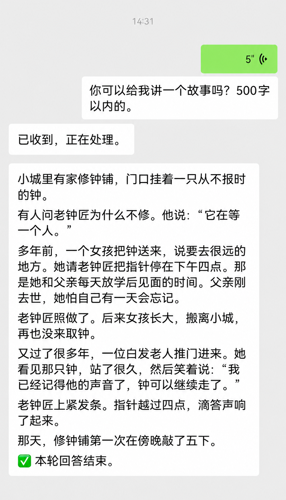
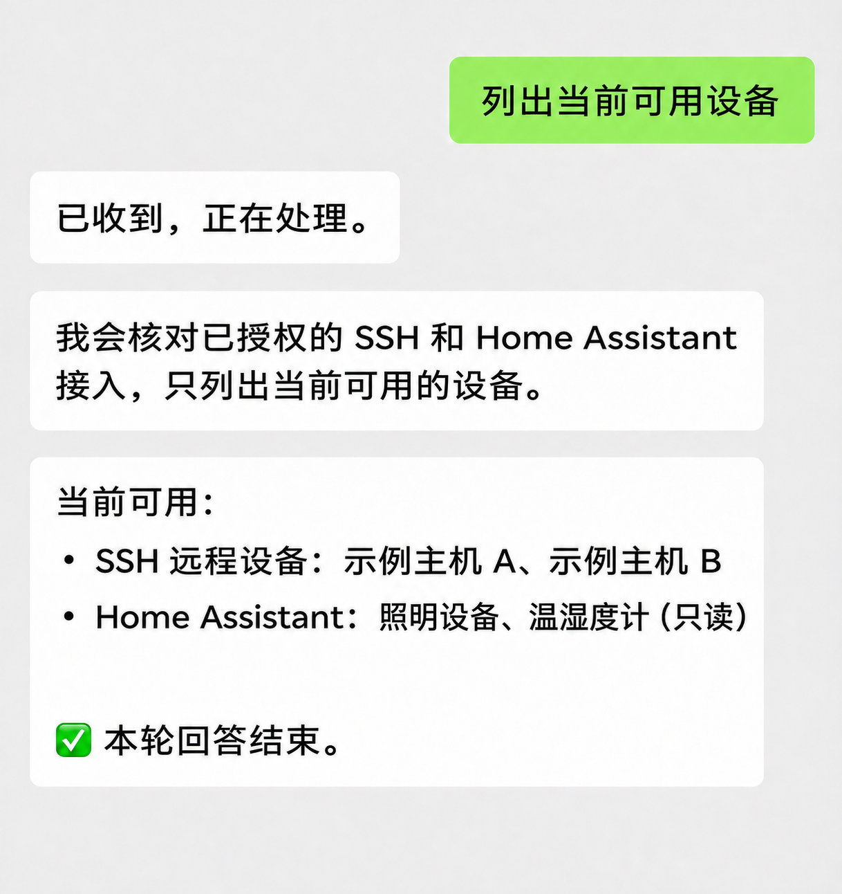
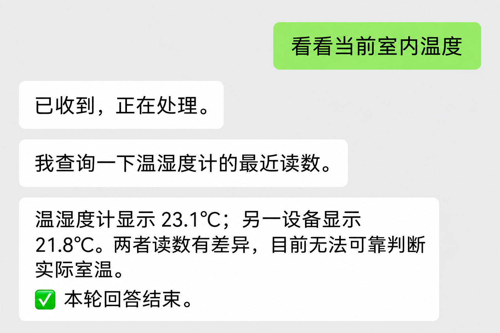

<div align="center">

# Weixin Link

**Away from your computer? Keep your agent working through WeChat.**

Start tasks · Add instructions · Check progress · Receive files

[简体中文](README.md) | [English](README.en.md)

[Quick start](#quick-start) · [Use cases](#use-cases) · [Common commands](#common-commands) · [Installation and upgrades](#installation-and-upgrades)

[](LICENSE)


</div>

Weixin Link connects WeChat private chats to **Codex** on your computer or server. While your computer or server stays online, you can start tasks, add instructions and receive answers and files from WeChat.

The pinned [WeChat SDK](https://www.npmjs.com/package/wechatbot-zerolink) is published from the independent `wechatbot-zerolink` repository; its version and integrity checksum are recorded in the lockfile.

<table align="center">
  <tr><th align="center">Clarify a city · Check the weather</th><th align="center">Transcribe speech · Write a story</th></tr>
  <tr>
    <td align="center" valign="top"></td>
    <td align="center" valign="top"></td>
  </tr>
  <tr><th align="center">Check available devices</th><th align="center">Compare device readings</th></tr>
  <tr>
    <td align="center" valign="top"></td>
    <td align="center" valign="top"></td>
  </tr>
</table>

<p align="center"><sub>Illustrations adapted from actual conversations. Device names, counts and readings have been replaced; available capabilities depend on current permissions.</sub></p>

## Quick start

**Run the installer → scan with WeChat → receive the setup wizard → reply with a number.** If the wizard does not appear, send `安装向导` to resume it. You need your own WeChat account and model access for your chosen agent backend. The installer prepares Node.js 24+ if needed.

**Linux / macOS** — run in a terminal:

```sh
curl -fsSL https://raw.githubusercontent.com/zhangjingwei/weixin-link/main/install.sh | sh
```

**Windows x64** — run in PowerShell:

```powershell
& ([scriptblock]::Create((Invoke-RestMethod 'https://raw.githubusercontent.com/zhangjingwei/weixin-link/main/install.ps1')))
```

Scan and confirm the pairing QR code in WeChat. The assistant then sends **安装向导** (setup wizard). The project dependencies include a pinned official Codex CLI runtime. Follow the prompts to sign in and run a model test, then send a task in your preferred language. Setup prompts and fixed control commands are currently in Chinese.

> Pairing confirms only the WeChat connection. Codex is confirmed after the wizard's model test. If setup needs attention, send **安装状态** (setup status).

<details>
<summary>Platform support and requirements</summary>

| Platform | Architectures | Requirements and validation |
| --- | --- | --- |
| Linux | arm64 / x64 | User-level systemd session and flock; existing deployment validation |
| macOS | Apple Silicon / Intel | Logged-in graphical session; pairing and text exchange verified, full validation ongoing |
| Windows | x64 | Current-user Task Scheduler and permission to run PowerShell scripts; full device testing pending |

Linux/macOS require curl and tar, plus a SHA-256 verification tool when installing private Node.js. The installer verifies official checksums and does not replace system Node.js. Windows ARM64 is not supported, and the installer does not change persistent execution policies.

[v1.3.2](https://github.com/zhangjingwei/weixin-link/releases/tag/v1.3.2) is released, with no long-term version compatibility guarantee yet. See [configuration and maintenance](CONFIGURATION.md) for details. Supporting guides are currently in Chinese.

</details>

## Use cases

These are example requests. Execution depends on your configured workspace, tools and service access.

| What you need | What to send in WeChat |
| --- | --- |
| **Keep working on code away from your desk** | “Find the failing tests in this project, fix them, and explain what changed.” |
| **Add requirements while a task runs** | “补充 Keep the existing interface and add a compatible implementation first.” |
| **Send material from your phone** | Attach a PDF: “Extract the key dates, amounts and action items.” |
| **Receive a usable file** | “Turn the results into a CSV file and send it to me.” |

- **Continue the same work:** Persistent conversations and task state, with switching between conversations.
- **Send more than text:** Images, PDFs and Office documents as input; text, images and generated files as output.
- **Stay in control:** Check progress, add instructions, stop tasks and reconcile uncertain results.
- **Run in your own environment:** Manage the bridge, conversations and credentials yourself. Model requests and WeChat communication still use the corresponding external services.

## Common commands

Send **日常** to return to your fixed everyday conversation, including after service restarts. Use `新建 Project name` for a separate project, then `日常` to return. Existing users keep their original conversation.

Send ordinary requests directly. These fixed commands control the bridge:

| Command | Purpose |
| --- | --- |
| `日常` | Return to the fixed everyday conversation |
| `诊断` | Show local diagnostics and service status for this account |
| `重启` | Restart this account's service when idle |
| `升级` | Upgrade a standard installation to the latest stable release when idle |
| `状态` | Check the current task and queue |
| `进度` | Check the current stage and most recent progress without queueing a task |
| `补充` | Prompt for instructions to add to the active task |
| `停止` | Cancel the current task and queued messages |
| `结果` | Retrieve the latest result without rerunning the task |
| `恢复` | Reconcile a submitted task whose result is uncertain |
| `新建` / `列表` | Create a conversation or list conversations |
| `切换 Number` / `历史` / `搜索` | Switch projects or inspect conversation history; search prompts for keywords |
| `归档 Number` / `还原 Number` / `删除 Number` | Archive, restore, or permanently delete a project |
| `模型` / `记忆` / `开启记忆` / `关闭记忆` | Inspect models and control native memory |
| `Codex会话列表` / `恢复Codex会话 Number` / `重置Codex会话` | Manage underlying Codex sessions |
| `长任务` / `长任务状态` | Save or inspect a Codex goal; send a separate request to start work |
| `计划` / `代码审查` | Start a Codex plan or review; reviews can also target a branch or commit |
| `压缩上下文` / `分叉会话` / `Codex状态` | Control the current Codex session |
| `批准 Code` / `拒绝 Code` / `回答 Code Answer` | Reply to a pending interaction using its displayed code |
| `安装状态` / `安装向导` | Check setup or continue installation and authentication |
| `命令列表` / `使用说明` | Read the command summary or full user guide |

Each message is processed independently. Text and attachments in the same message are submitted together. See the [user guide](USER-GUIDE.md) for conversation management, attachment limits and diagnostic commands.
For `补充`, `新建`, `命名`, `搜索`, `长任务`, and `计划`, send the command first, then reply to its prompt with the requested text. Send `取消` to abandon a pending prompt.
These Chinese controls invoke the corresponding Codex capabilities; see the [user guide](USER-GUIDE.md) for exact forms and limits. Send other tasks as ordinary requests without slash commands.

WeChat voice messages with a complete transcript also support system commands such as `列表`, `状态`, and `停止`.

## Installation and upgrades

To upgrade, rerun the command for your platform in [Quick start](#quick-start). User-approved upgrades from WeChat support installer-managed deployments; see [configuration and maintenance](CONFIGURATION.md#已有安装与升级) for custom deployments, QR refresh and recovery.

Standard installations check stable GitHub Releases (`vX.Y.Z`) hourly and offer upgrades by version, never by new main commits. Prereleases and automatic downgrades are excluded. Approval pins the release commit for verification. No stable release means no upgrade; there is no fallback to main. Uncertain notification delivery is not automatically retried.

## Login QR codes

The commands below apply to Linux/macOS. On Windows, the installer provides the initial QR code.

### First login

Run the [installation command](#quick-start); the installer prepares the service and shows the QR code for the default account. If already installed but not yet paired, run:

```sh
/bin/bash -c "$(curl -fsSL https://raw.githubusercontent.com/zhangjingwei/weixin-link/main/qr.sh)"
```

### Login again after an upgrade

Upgrading does not require another scan while the WeChat binding is valid. If the account was unbound, or its service is running but not ready, explicitly start a new login:

```sh
WEIXIN_LINK_RELOGIN=1 /bin/bash -c "$(curl -fsSL https://raw.githubusercontent.com/zhangjingwei/weixin-link/main/qr.sh)"
```

### Login with another account

Use a separate profile for each WeChat account. Create the profile in the installed source directory, then get its QR code. Skip the creation command if the profile already exists:

```sh
cd ~/.local/share/weixin-link/source
PATH="$HOME/.local/share/wechat-ping-bot/tools/node/bin:$PATH" node src/setup/account-manager.mjs create bot2
./qr.sh bot2
```

If the `bot2` service is still running and needs a new login, use `./qr.sh --relogin bot2`. The command waits for login; if WeChat requests a PIN, enter it when prompted in the same terminal. Set `WEIXIN_LINK_QR_STYLE=full` if terminal QR cells have gaps. See [QR maintenance](CONFIGURATION.md#二维码维护) for custom installation paths and other options.

## More capabilities and documentation

**Codex** handles tasks. SSH operations on remote hosts do not require Codex there.

- [User guide](USER-GUIDE.md): conversations, models, memory, attachments and results.
- [Configuration and maintenance](CONFIGURATION.md): installation, upgrades, backups and troubleshooting.
- [Remote connections](src/infrastructure/remote/README.md): connect authorized remote workspaces.
- [Configuration examples](config-templates/): deployment references.
- [Contributing](CONTRIBUTING.md): report issues and contribute changes.

Optional integrations: [Home Assistant read-only queries, SSH remote operations, and RSSHub feeds](src/integrations/README.md) require explicit per-account enablement. Backup migration to this interface remains pending.

## Security and license

Pair with your own WeChat account. Do not share login QR codes or device authorization codes. Authenticate Codex on the official OpenAI authorization page. Grant access only to the workspaces and services you intend to use. See the [security policy](SECURITY.md) for reporting issues.

Licensed under the [MIT License](LICENSE). Third-party dependencies and external services have their own terms; see [third-party notices](THIRD_PARTY_NOTICES.md). Weixin Link is an independent project, not an official product of, or endorsed by, WeChat, OpenAI or other service providers.
