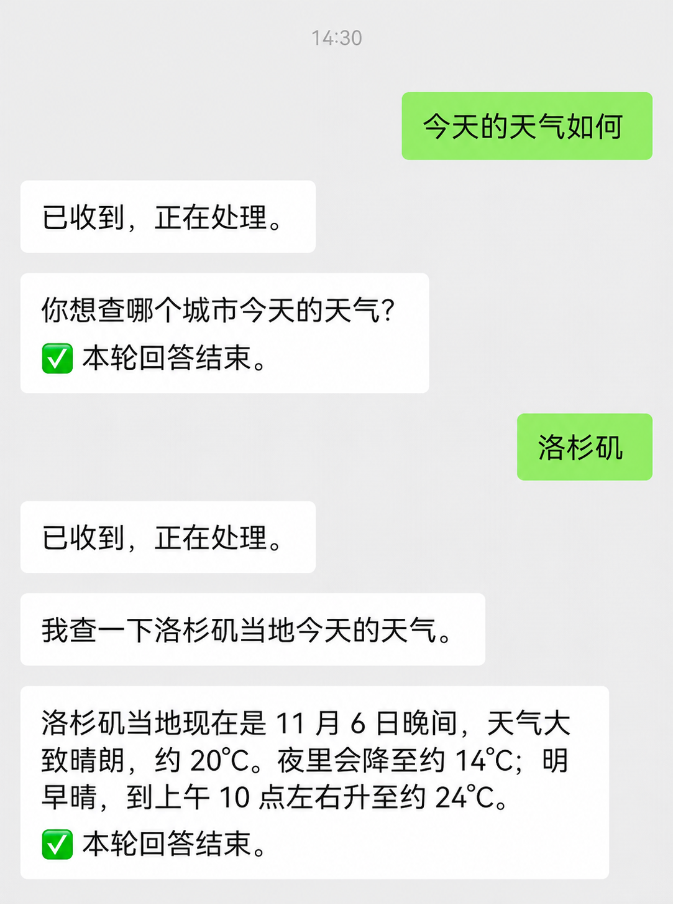
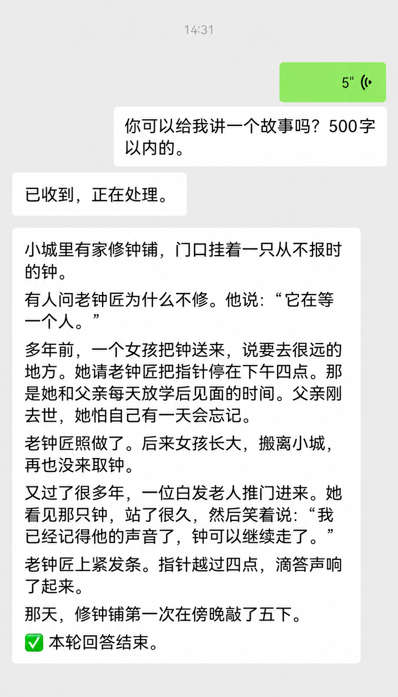
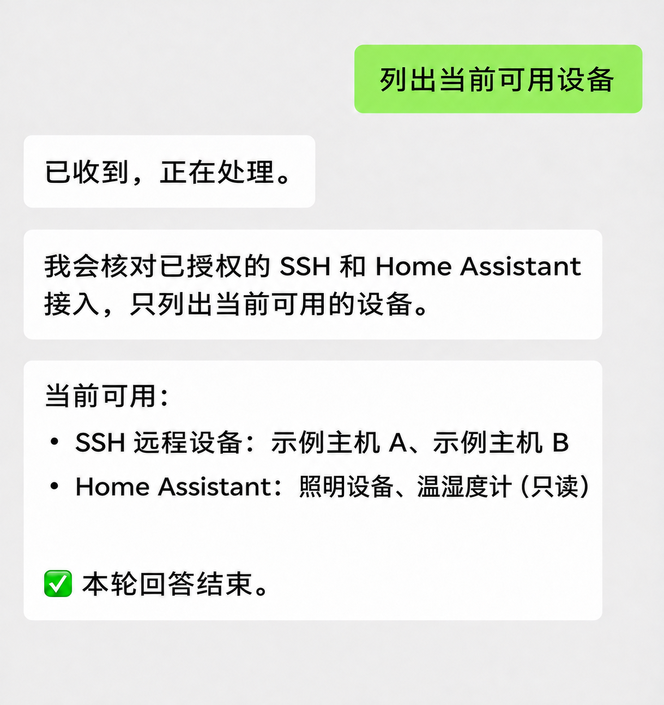
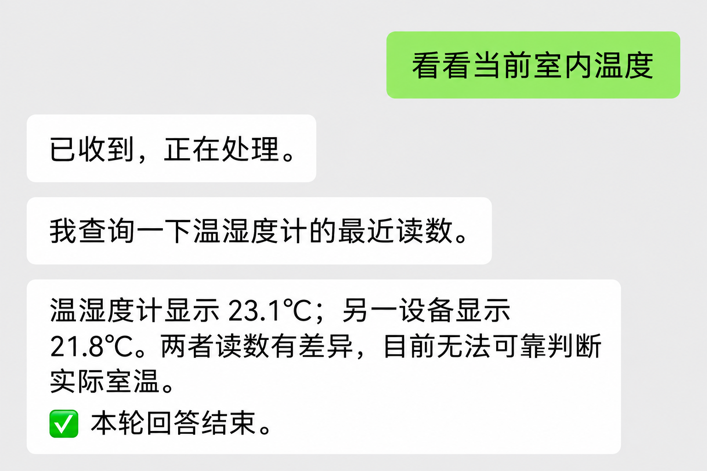

<div align="center">

# Weixin Link

**Your own AI assistant, right in WeChat.**

Research, plan, and get results.

[简体中文](README.md) | [English](README.en.md)

[Quick start](#quick-start) · [Use cases](#use-cases) · [Natural-language use](#natural-language-use) · [Built-in workflows](#built-in-workflows) · [Installation and upgrades](#installation-and-upgrades)

[](LICENSE)


</div>

**Security & privacy:** Install it on your own computer; your account and keys stay under your control.

**Personal assistant:** Your own AI with memory, getting more useful the more you use it.

**Smarter AI:** Choose the model; the agent does the work. It plans, uses tools, and takes complex tasks from start to finish.

**Start with an idea:** Design discussion helps you work out what you need; the delivery assistant carries it through. Code, campaigns or reports can start with a plain-language request.

<table align="center">
  <tr><th align="center">Clarify a city · Check the weather</th><th align="center">Transcribe speech · Write a story</th></tr>
  <tr>
    <td align="center" valign="top"></td>
    <td align="center" valign="top"></td>
  </tr>
  <tr><th align="center">Check available devices</th><th align="center">Compare device readings</th></tr>
  <tr>
    <td align="center" valign="top"></td>
    <td align="center" valign="top"></td>
  </tr>
</table>

<p align="center"><sub>Illustrations adapted from actual conversations. Device names, counts and readings have been replaced; available capabilities depend on current permissions.</sub></p>

## Quick start

**Run the installer → configure model access and choose a working model → open the WeChat login address and confirm.** You need your own WeChat account and a Codex subscription or supported model service. The installer prepares Node.js 24+ if needed.

**Linux / macOS** — run in a terminal:

```sh
curl -fsSL https://raw.githubusercontent.com/zhangjingwei/weixin-link/main/install.sh | sh
```

**Windows x64** — run in PowerShell:

```powershell
& ([scriptblock]::Create((Invoke-RestMethod 'https://raw.githubusercontent.com/zhangjingwei/weixin-link/main/install.ps1')))
```

The installer offers subscription sign-in, DeepSeek, Qwen or Kimi. After Codex subscription authorization, choose from the models actually available to your account; the wizard identifies the current/default options and reads back the saved setting. This changes your personal Codex default, shared with desktop and CLI. Existing conversations and explicit project overrides retain priority. A real inference test is optional; setup checks the account's Codex protocol by default.

The installer shows a WeChat login address and tries to open it in your browser. Enter third-party API keys only in the terminal. Setup supports Chinese and English; some advanced diagnostics remain in Chinese.

**For users in mainland China:** [Codex subscription sign-in](https://learn.chatgpt.com/docs/auth) requires your own account and a connection to OpenAI services. If OpenAI is unavailable from your location or network, this option will not work. DeepSeek, Qwen and Kimi use keys from their own platforms instead of Codex subscription sign-in. Confirm your choice with the setup wizard's model test.

The setup wizard automatically uses Chinese or English.

> Pairing confirms only the WeChat connection. The optional inference test checks a real model reply. If setup needs attention, send **setup-status**.

<details>
<summary>Platform support and requirements</summary>

| Platform | Architectures | Requirements and validation |
| --- | --- | --- |
| Linux | arm64 / x64 | Validated in an existing deployment |
| macOS | Apple Silicon / Intel | Logged-in graphical session; pairing and text exchange verified, full validation ongoing |
| Windows | x64 | Permission to run PowerShell scripts; full device testing pending |

Linux/macOS require curl and tar. Windows ARM64 is not supported.

See the [latest release](https://github.com/zhangjingwei/weixin-link/releases/latest). Long-term version compatibility is not yet guaranteed. See [configuration and maintenance](CONFIGURATION.md) for details.

</details>

## Use cases

These are example requests. Execution depends on your configured workspace, tools and service access.

| What you need | What to send in WeChat |
| --- | --- |
| **Keep working on code away from your desk** | “Find the failing tests in this project, fix them, and explain what changed.” |
| **Add requirements while a task runs** | “Add this to the current task: keep the existing interface and add a compatible implementation first.” |
| **Send material from your phone** | Attach a PDF: “Extract the key dates, amounts and action items.” |
| **Receive a usable file** | “Turn the results into a CSV file and send it to me.” |

- **Continue the same work:** Check progress, follow up, or assign work to different projects in the same WeChat conversation.
- **Send more than text:** Images, PDFs and Office documents as input; text, images, videos and generated files as output. Images and videos arrive as separate messages.
- **Stay in control:** Check progress, add instructions or stop tasks from WeChat.

## Natural-language use

Stay in one entry and describe your intent: ask for knowledge-project progress, ask the toolbox project to improve search, supplement a named running task, stop that task, or query its result. Ask to check updates, upgrade to the checked release, or restart this account.

The assistant checks which project you mean and asks if the name is unclear. Progress and results show a project name and readable task title. Different projects can work separately; tasks within one project run in order. Queued work is not finished work.

You can ask two projects to work in one message, or say “First do …, then …” when one task depends on another. You can cancel work that has not started or move it earlier in the queue. Reordering does not interrupt a running task.

To send material to a project, attach it and name the project. Generated reports, JSON and HTML deliverables come back as WeChat file attachments; download HTML and open it in a browser. Old files from other conversations are not forwarded automatically. Keep the installation computer running and connected to use the assistant.

The assistant uses context and management tools to find, create or resume conversations. Ordinary questions and design discussions stay in the current conversation by default; a topic change alone does not create a new one. You can explicitly request a new conversation or resume a previous one. Grouping related conversations requires verification of their actual Git repository and preserves each working directory and history.

If the model is unavailable, stop, service-status and install-help remain available. See the [exact command reference](docs/reference/commands.en.md) for recovery and the [user guide](USER-GUIDE.en.md) for daily workflows.

## Built-in workflows

### 💡 Design discussion: start before you have every detail

You do not need a finished requirements document. Say “I want an equipment inspection system,” and the assistant helps compare approaches, spot missing details and clarify choices that affect the design, such as what happens when the workshop loses connectivity. It carries the agreed goal, approach and acceptance criteria into the work that follows.

### 📦 Delivery assistant: turn the agreed plan into something usable

Say “Build it using this plan.” The assistant uses the context you have already agreed on, locates the project, breaks complex work into manageable steps, checks the results and delivers code, documents or files. You can see what was completed, how to use it and what remains unfinished without repeating the brief. Ask explicitly if you want to approve a blueprint first or review each stage.

### 📝 Message layout: easy to read, ready to reuse

Clear lists for steps, preserved indentation for code, and separate copy-ready text blocks for meeting notes and drafts. Images, videos and files are delivered directly, so you spend less time reformatting results or removing explanatory text from a draft.

These workflows also help with campaigns, research and reports. Simple questions still get direct answers. Execution depends on your authorization, available tools and environment; incomplete or unverified work is identified.

Code-block copy controls, image viewing/saving and short MP4 playback have been tested in the current client. Explanatory text arrives before separate media messages, rather than inline media. Other clients and media encodings require validation. Tables become readable text records; do not rely on complex Markdown styling or LaTeX rendering.

### Same-Mac desktop handoff (experimental)

An opt-in macOS feature opens the original WeChat conversation on the desktop and resumes it in WeChat after return. It is disabled by default and supports Codex subscription sign-in only. Tasks for that WeChat account pause during handoff and resume after the desktop closes and the original thread is verified idle. Desktop list visibility and UI behavior still require real validation. See [desktop handoff details](docs/features/codex-desktop-handoff.md) (Chinese).

## Installation and upgrades

Ask whether a new release is available, then explicitly ask to upgrade to that checked release. The worker waits for idle, prepares temporary rollback data, upgrades and checks health, then removes temporary data after success. Ask to skip just that release to keep future notifications. Exact check-updates, upgrade and restart commands remain available when the model cannot be used.

To upgrade, rerun the installation command in [Quick start](#quick-start) and choose **Upgrade**. Standard installations also prompt you when a stable update is available and upgrade only after you confirm. See [configuration and maintenance](CONFIGURATION.md#已有安装与升级) for custom deployments and recovery.

The installer guides you through the first WeChat login. To log in again later, rerun the same installation command and choose **Log in to WeChat again** from the menu. You do not need to find the installation directory.

**Linux / macOS**:

```sh
curl -fsSL https://raw.githubusercontent.com/zhangjingwei/weixin-link/main/install.sh | sh
```

**Windows x64**:

```powershell
& ([scriptblock]::Create((Invoke-RestMethod 'https://raw.githubusercontent.com/zhangjingwei/weixin-link/main/install.ps1')))
```

Weixin Link is a single-user installation and uses your personal Codex home. See [WeChat login maintenance](CONFIGURATION.md#微信登录维护) for other cases.

To uninstall, rerun the same command, choose **Uninstall**, and confirm. Account data and the workspace are kept.

## Troubleshooting

### Trace a message through the service

Run `npm run logs` in the source directory, then send a WeChat message. The terminal shows new intake, model-processing and delivery events in Chinese, with local timestamps and recorded step durations. Press Ctrl+C to stop viewing logs; the service keeps running.

### Codex subscription sign-in says device code authorization is disabled

The installer uses device-code sign-in. In ChatGPT **Settings → Security**, enable **Device code authorization** (also called device code sign-in; wording may vary), then follow the official link and code shown in the installation terminal. For a managed workspace, an admin must allow device code login in workspace permissions.

If authorization was rejected or the code expired, enable the setting, rerun the installer, choose **Configure model → Subscription sign-in**, and use the newly displayed code. This setting applies to Codex subscription device-code login; third-party API key setup does not need it. For other failures, check the reported error, network, or account permissions.

See the [official OpenAI device-code login guide](https://learn.chatgpt.com/docs/auth#preferred-device-code-authentication-beta).

### Subscription authorization succeeded, but the model test timed out

By default the installer checks the Codex protocol for this account and continues to WeChat sign-in. To test a real reply, send **check-agent** in WeChat or run `node src/setup/setup.mjs wizard --verify-model` in the terminal. The optional terminal test waits up to about three minutes. You can retry it with your existing authorization.

## More capabilities and documentation

Stay in one WeChat entry and ask a named project to do work. Explicit cross-project text tasks enter that project’s durable queue and return progress and results without switching conversations. Queries do not create tasks, and attachments are not forwarded implicitly.

- [User guide](USER-GUIDE.en.md): conversations, models, memory, attachments and results.
- [Configuration and maintenance](CONFIGURATION.md): installation, upgrades, backups and troubleshooting.
- [Remote connections](src/infrastructure/remote/README.md): connect authorized remote workspaces.
- [Configuration examples](config-templates/): deployment references.
- [Contributing](CONTRIBUTING.md): report issues and contribute changes.

Optional integrations: [Home Assistant read-only queries, SSH remote operations, and RSSHub feeds](src/integrations/README.md) require explicit per-account enablement.

See [artifact delivery and retention](docs/artifact-delivery.md) (Chinese) for private staging, delivery failures, source cleanup, and the 7-day replay window.

## Security and license

Confirm login with your own WeChat account. Do not share login addresses or device authorization codes. For subscription sign-in, use the official OpenAI authorization page. Grant access only to the workspaces and services you intend to use. See the [security policy](SECURITY.md) for reporting issues.

Licensed under the [MIT License](LICENSE). Third-party dependencies and external services have their own terms; see [third-party notices](THIRD_PARTY_NOTICES.md). Weixin Link is an independent project, not an official product of, or endorsed by, WeChat, OpenAI or other service providers.
