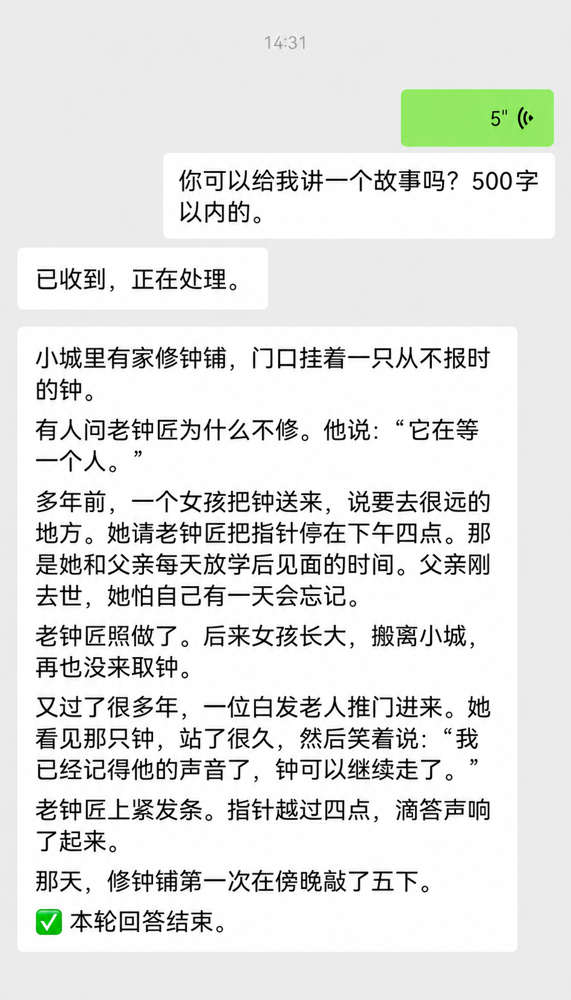

<div align="center">

# Weixin Link

**你的专属 AI 助手，随时在微信里。**

查资料、想方案、出结果。

[简体中文](README.md) | [English](README.en.md)

[快速开始](#快速开始) · [使用场景](#使用场景) · [自然语言使用](#自然语言使用)

[](LICENSE)


</div>

**安全隐私：** 装在你自己的电脑上，账号和密钥握在自己手里。

**个人助理：** 专属AI，拥有记忆，越用越顺手

**更好用的智能：** 模型你来选，智能体来干活：会规划、会用工具，复杂的事也能从头做到尾。

<table align="center">
  <tr><th align="center">追问城市 · 查询天气</th><th align="center">语音转写 · 生成故事</th></tr>
  <tr>
    <td align="center" valign="top"></td>
    <td align="center" valign="top"></td>
  </tr>
  <tr><th align="center">核对可用设备</th><th align="center">查询设备读数</th></tr>
  <tr>
    <td align="center" valign="top"></td>
    <td align="center" valign="top"></td>
  </tr>
</table>

<p align="center"><sub>对话示意图根据实际交流整理；设备名称、数量和读数已替换。可用能力取决于当前授权。</sub></p>

## 快速开始

安装时用方向键选择，回车确认。

### 首次安装

Linux / macOS：

```sh
curl -fsSL https://raw.githubusercontent.com/zhangjingwei/weixin-link/main/install.sh | sh
```

Windows x64（PowerShell）：

```powershell
& ([scriptblock]::Create((Invoke-RestMethod 'https://raw.githubusercontent.com/zhangjingwei/weixin-link/main/install.ps1')))
```

按提示选择模型、登录微信。中国大陆如果无法访问 OpenAI，使用 [Codex 订阅](https://learn.chatgpt.com/docs/auth) 需自行解决访问问题；DeepSeek、Qwen、Kimi 不受此限制。

### 升级

可以直接说“看看有没有新版本”，核对后说“升级到刚才查到的版本”；升级会在空闲后备份、切换并检查健康状态。也可说“这个版本先不升级”，仅跳过该版本。模型不可用时，精确的“检查更新”“升级”“重启”等入口仍保留。

运行命令，在菜单中选择“升级”：

```sh
curl -fsSL https://raw.githubusercontent.com/zhangjingwei/weixin-link/main/install.sh | sh
```

Windows x64（PowerShell）：

```powershell
& ([scriptblock]::Create((Invoke-RestMethod 'https://raw.githubusercontent.com/zhangjingwei/weixin-link/main/install.ps1')))
```

### 重新登录微信

运行命令，在菜单中选择“重新登录微信”：

```sh
curl -fsSL https://raw.githubusercontent.com/zhangjingwei/weixin-link/main/install.sh | sh
```

Windows x64（PowerShell）：

```powershell
& ([scriptblock]::Create((Invoke-RestMethod 'https://raw.githubusercontent.com/zhangjingwei/weixin-link/main/install.ps1')))
```

### 卸载

运行命令，在菜单中选择“卸载”，按提示确认：

```sh
curl -fsSL https://raw.githubusercontent.com/zhangjingwei/weixin-link/main/install.sh | sh
```

Windows x64（PowerShell）：

```powershell
& ([scriptblock]::Create((Invoke-RestMethod 'https://raw.githubusercontent.com/zhangjingwei/weixin-link/main/install.ps1')))
```

卸载会保留账号数据和工作区。

支持 Linux（x64、arm64）、macOS（Intel、Apple Silicon）和 Windows（x64）。

## 使用场景

以下是请求示例，实际执行依赖你配置的工作区、工具和服务权限。

| 你想做什么 | 在微信里怎么说 |
| --- | --- |
| **离开电脑后继续处理代码** | “检查这个项目的测试失败原因，修复后告诉我改了什么。” |
| **随时补充任务要求** | “给当前任务补充：先保留原接口，再增加兼容实现。” |
| **把手机上的材料交给智能体** | 发一份 PDF，再说：“提取关键日期、金额和待办事项。” |
| **直接拿到可用的文件** | “把刚才的结果整理成 CSV 文件发给我。” |

- **继续同一个任务**：可以查询进度、继续追问，也可以在同一个微信对话里安排不同项目。
- **文字之外也能传材料**：接收图片、PDF、Office 文档等附件，交付文本、图片和生成的文件。
- **执行过程可掌握**：在微信查看进度、补充要求或停止任务。

## 自然语言使用

留在一个微信入口，直接说需求即可：

- “知识库项目做到哪一步了？”
- “让工具箱优化搜索页面，保持现有接口。”
- “给知识库当前任务补充：需要支持 PDF。”
- “停止工具箱当前任务”“查一下上次的结果”。
- “看看有没有新版本”“升级到刚才查到的版本”“重启当前账号”。

助手会先确认你说的是哪个项目，名称不清楚时会追问。进度和结果会标出项目名与任务名称，不需要来回切换。不同项目可以分别工作，同一项目的任务按顺序执行；“已排队”表示还没做完。

还可以说“知识库检查搜索，工具箱优化页面”，一次安排多个项目；有先后要求时说“先做……完成后再做……”。想调整安排，可以说“取消知识库还没开始的任务”或“把修复搜索排到前面”。调整顺序不会打断正在执行的任务。

发送附件时说明“把这份文件交给知识库分析”。任务生成报告、JSON 或 HTML 等成果时，会以微信附件发回；HTML 下载后可用浏览器打开。不会把其他聊天里的旧文件自动交给新任务。

模型不可用时，仍可发送“停止”“状态”“安装帮助”等应急命令。完整人工操作见[精确命令参考](docs/reference/commands.md)，日常流程见[使用指南](USER-GUIDE.md)。

## 常见问题

### Codex 订阅登录提示未开启 Device code authorization

安装器使用设备码登录。先在 ChatGPT 的「设置 → 安全」中开启 **Device code authorization**（设备码授权／设备码登录，名称可能随界面变化），再按安装终端显示的官方链接和设备码完成授权。受管理的工作区需由管理员在工作区权限中允许设备码登录。

如果刚才已被拒绝或设备码已过期，开启后重新运行安装命令，选择「配置模型 → 订阅登录」，使用本次新显示的设备码。此设置只与 Codex 订阅的设备码登录有关；第三方模型的 API Key 配置不需要它。其他登录失败仍需按实际错误检查网络或账号权限。

参见 [OpenAI 官方设备码登录说明](https://learn.chatgpt.com/docs/auth#preferred-device-code-authentication-beta)。

### 已完成订阅授权，但模型测试超时

授权成功后，安装器还要确认模型能否正常回答，最多等待约 3 分钟。出现 `MODEL_PROBE_TIMEOUT` 表示这次测试没能及时得到结果，不代表登录失败。选择「仅重试模型测试」即可保留已有登录；也可以稍后再配置。

## 更多能力与文档

当前功能和更新内容见[版本发布页](https://github.com/zhangjingwei/weixin-link/releases/latest)。使用仍需要安装电脑保持运行并能联网。

- [使用指南](USER-GUIDE.md)：会话、模型、记忆、附件与结果。
- [配置与维护](CONFIGURATION.md)：安装、升级、备份和故障处理。
- [远程连接](src/infrastructure/remote/README.md)：连接已授权的远程工作区。
- [可选集成](src/integrations/README.md)：HA 只读查询、SSH 远端操作和 RSSHub 新闻源，按账号显式启用；备份统一接入仍待迁移。
- [配置示例](config-templates/)：部署配置参考。
- [参与贡献](CONTRIBUTING.md)：问题反馈与代码贡献。

文件交付的存放位置、失败状态、原件清理和 7 天重发保留期见[文件交付与临时文件生命周期](docs/artifact-delivery.md)。

## 安全与许可

使用自己的微信账号确认登录，不要分享登录地址或设备验证码。选择订阅登录时，请在官方 OpenAI 页面授权。只授权助手访问你允许的工作区和服务。安全问题请参阅 [安全政策](SECURITY.md)。

本项目采用 [MIT License](LICENSE)。第三方依赖与外部服务遵循各自条款，见 [第三方许可](THIRD_PARTY_NOTICES.md)。Weixin Link 是独立项目，不代表微信、OpenAI 或其他服务提供方的官方产品或背书。
