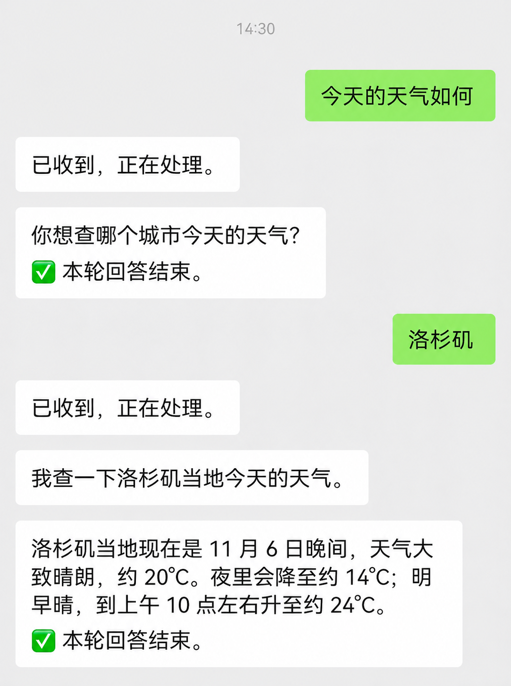
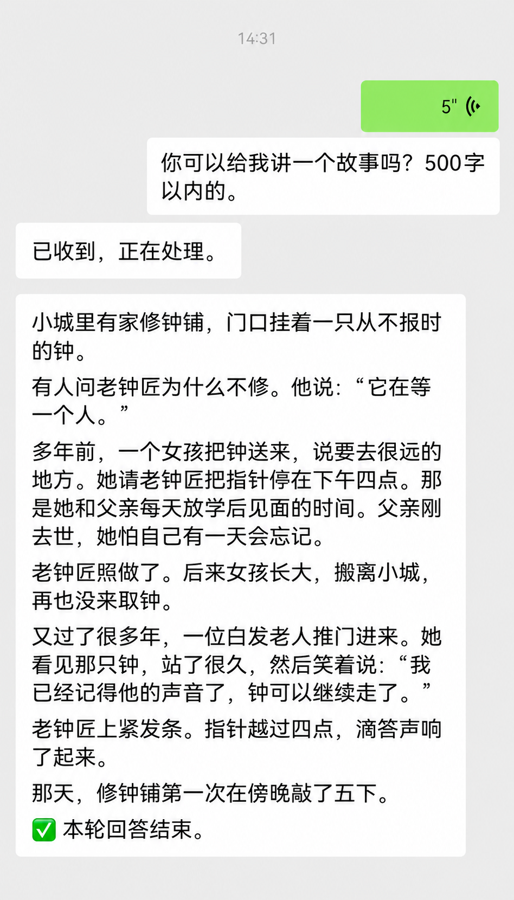
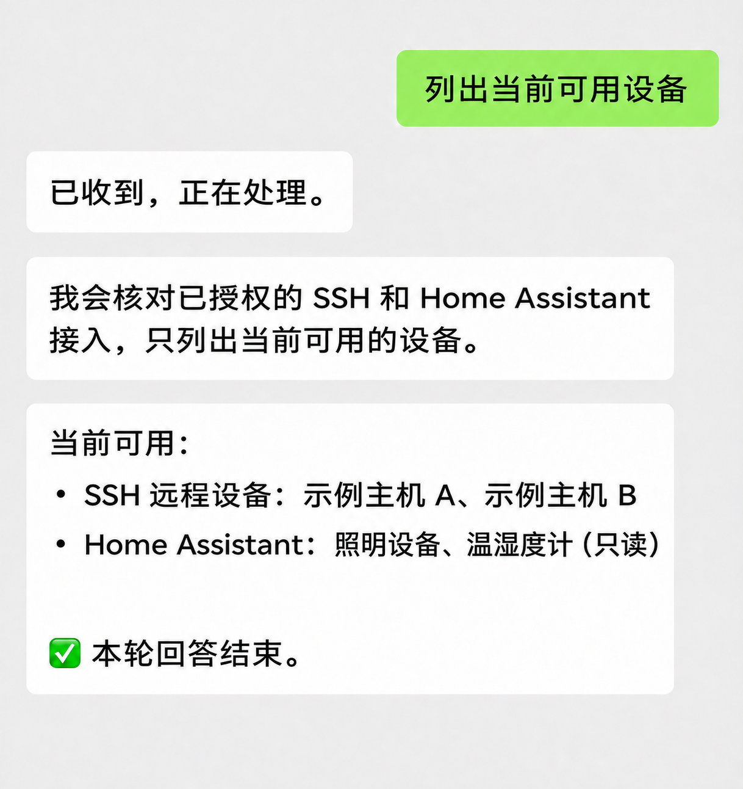
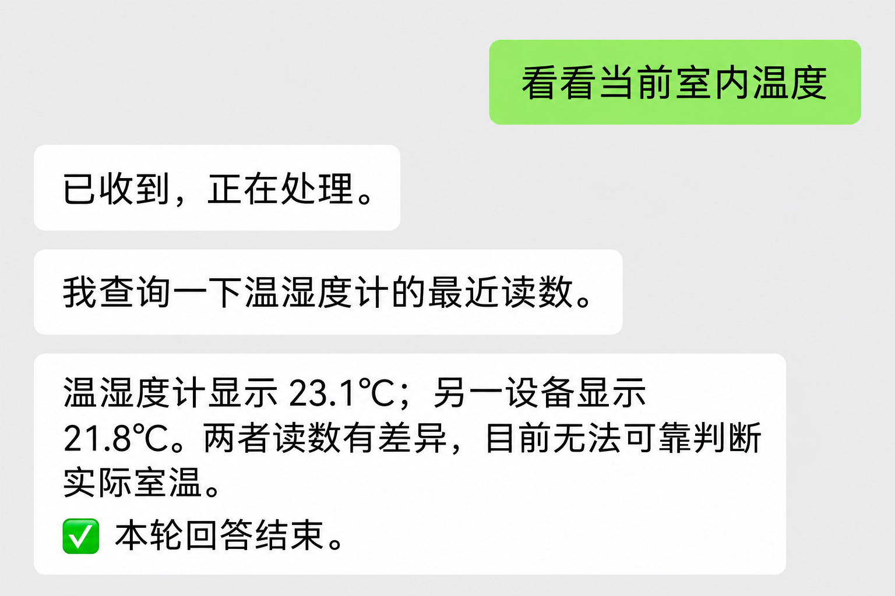

<div align="center">

# Weixin Link

**离开电脑，也能用微信让智能体继续干活。**

发任务 · 补充要求 · 查看进度 · 接收文件

[简体中文](README.md) | [English](README.en.md)

[快速开始](#快速开始) · [使用场景](#使用场景) · [常用命令](#常用命令) · [安装与升级](#安装与升级)

[](LICENSE)


</div>

Weixin Link 把微信私聊接到你电脑或服务器上的**智能体底座**。目前支持 Codex（默认）和 Claude CLI。电脑或服务器保持在线时，你可以从微信发起任务、补充要求，并接收回答和文件。

<table align="center">
  <tr><th align="center">追问城市 · 查询天气</th><th align="center">语音转写 · 生成故事</th></tr>
  <tr>
    <td align="center" valign="top"></td>
    <td align="center" valign="top"></td>
  </tr>
  <tr><th align="center">核对可用设备</th><th align="center">查询设备读数</th></tr>
  <tr>
    <td align="center" valign="top"></td>
    <td align="center" valign="top"></td>
  </tr>
</table>

<p align="center"><sub>对话示意图根据实际交流整理；设备名称、数量和读数已替换。可用能力取决于当前授权。</sub></p>

## 快速开始

**运行安装命令 → 微信扫码 → 查看助手的欢迎消息 → 发送「安装向导」。** 助手会在连接后主动尝试发送简短说明；如果微信暂未显示，仍可直接发送「安装向导」。需要自己的微信账号，以及所选智能体底座的模型访问权限；Node.js 24+ 由安装器按需准备。

**Linux / macOS**：在电脑终端执行：

```sh
curl -fsSL https://raw.githubusercontent.com/zhangjingwei/weixin-link/main/install.sh | sh
```

**Windows x64**：在 PowerShell 执行：

```powershell
& ([scriptblock]::Create((Invoke-RestMethod 'https://raw.githubusercontent.com/zhangjingwei/weixin-link/main/install.ps1')))
```

用微信扫描安装器提供的二维码并确认，然后发送 **安装向导**。默认的 Codex 底座可按提示完成安装、登录和模型测试；Claude CLI 需先配置可执行文件与服务凭据。完成后，直接发一句任务需求即可。

> 扫码成功只确认微信通道。Codex 向导的模型测试通过后，才能确认 Codex 可处理请求；Claude 的安装状态只检查 CLI 与凭据，实际模型请求需另行验收。安装遇到问题时，发送 **安装状态**。

<details>
<summary>平台支持与安装要求</summary>

| 平台 | 支持架构 | 要求与验证状态 |
| --- | --- | --- |
| Linux | arm64 / x64 | 用户级 systemd 会话及 flock；已有部署验证 |
| macOS | Apple Silicon / Intel | 已登录的图形会话；已验证扫码和文字收发，完整验收仍在进行 |
| Windows | x64 | 当前用户计划任务、允许运行 PowerShell 脚本；待完整真机验收 |

Linux/macOS 需要 curl、tar；安装私有 Node.js 时还需要 SHA-256 校验工具。安装器验证官方校验和，不覆盖系统 Node.js。Windows ARM64 暂不支持，安装器不修改持久执行策略。

已发布正式版 [v1.2.0](https://github.com/zhangjingwei/weixin-link/releases/tag/v1.2.0)，尚无长期版本兼容承诺。更多要求与维护步骤见 [配置说明](CONFIGURATION.md)。

</details>

## 使用场景

以下是请求示例，实际执行依赖你配置的工作区、工具和服务权限。

| 你想做什么 | 在微信里怎么说 |
| --- | --- |
| **离开电脑后继续处理代码** | “检查这个项目的测试失败原因，修复后告诉我改了什么。” |
| **随时补充任务要求** | “补充 先保留原接口，再增加兼容实现。” |
| **把手机上的材料交给智能体** | 发一份 PDF，再说：“提取关键日期、金额和待办事项。” |
| **直接拿到可用的文件** | “把刚才的结果整理成 CSV 文件发给我。” |

- **继续同一个任务**：保留会话与任务状态，支持多个对话之间切换。
- **文字之外也能传材料**：接收图片、PDF、Office 文档等附件，交付文本、图片和生成的文件。
- **执行过程可掌握**：智能体的阶段进展形成完整语句时即发送到微信；也可查询状态、补充要求、停止任务或核对未确认的结果。最终回答仍在完成后发送。
- **部署在自己的环境**：接入服务、会话和凭据由你管理；模型请求与微信通信仍经过相应外部服务。

## 常用命令

发送 **日常** 返回固定的日常会话，后续消息持续复用，服务重启后保留。独立项目用“新建 项目名”，发“列表”查看项目，发“日常”返回日常对话。项目与日常在助手内分别保存，共用一个微信聊天窗口。

普通需求直接发送即可。下面这些是固定控制命令：
程序通知在原消息末尾标“〔系统通知〕”；助手最终答复保留独立的结束标记，不额外发送一条收尾消息。

| 命令 | 用途 |
| --- | --- |
| `日常` | 返回固定日常会话 |
| `诊断` | 查看当前账号日志与服务状态 |
| `重启` | 本账号空闲后重启服务 |
| `升级` | 标准安装空闲后升级到最新正式版本 |
| `状态` | 查看当前任务与队列 |
| `进度` / `进度如何了` | 立即查看处理阶段和最近一次已发出的进展；不会排入任务队列 |
| `补充 内容` | 向正在执行的任务追加要求 |
| `停止` | 取消当前任务与排队消息 |
| `结果` | 取回最近结果，不重新执行任务 |
| `恢复` | 核对已经提交、但结果尚未确认的任务 |
| `新建 项目名` / `列表` | 新建项目、查看项目列表；日常不列入 |
| `切换编号` / `历史` / `搜索 关键词` | 切换项目、查看当前项目历史及最近消息 |
| `归档编号` / `还原编号` / `删除编号` | 管理项目；删除会永久移除 |
| `模型` / `记忆` / `开启记忆` / `关闭记忆` | 查看模型与原生记忆状态，控制当前会话记忆模式 |
| `Codex会话列表` / `恢复Codex会话 编号` / `重置Codex会话` | 管理底层 Codex 会话；重置会创建新会话 |
| `批准 编号` / `拒绝 编号` / `回答 编号 答案` | 回复当前任务发出的交互请求；编号以收到的提示为准 |
| `安装状态` / `安装向导` | 检查配置、继续安装与登录 |
| `切换智能体` / `切换智能体 Codex` / `切换智能体 Claude` | 查看当前底座，或在本账号空闲后切换已配置的底座 |
| `命令列表` / `使用说明` | 查看控制命令摘要或完整帮助 |

每条消息独立处理，同一条中的文字和附件一起提交。会话管理、附件限制和诊断命令见 [使用指南](USER-GUIDE.md)。
长任务、代码审查等需求直接用自然语言描述；这些是普通 Codex 任务，不会触发专用斜杠命令。

微信语音附带完整转写时，也可使用“列表”“状态”“停止”等系统指令。

## 安装与升级

升级时，重新执行[快速开始](#快速开始)中对应平台的安装命令。微信内确认升级仅适用于安装器管理的标准部署；自定义部署、扫码刷新和恢复步骤见 [配置与维护](CONFIGURATION.md#已有安装与升级)。

标准安装每小时检查 GitHub 正式 Release（`vX.Y.Z`），按版本号提示升级，不跟随主干提交、不自动降级，也不选择预发布版。只有明确同意才会升级；执行时固定该版本对应的提交用于完整性校验。没有正式 Release 时不会回退到主干。投递结果不明的提醒不自动重发。

## 重新获取登录二维码

Linux / macOS：

```sh
/bin/bash -c "$(curl -fsSL https://raw.githubusercontent.com/zhangjingwei/weixin-link/main/qr.sh)"
```

二维码有断缝时，加 `WEIXIN_LINK_QR_STYLE=full`；解绑后重新登录，加 `WEIXIN_LINK_RELOGIN=1`。参数放在命令前，详见 [二维码维护](CONFIGURATION.md#二维码维护)。

## 更多能力与文档

目前支持 **Codex**（默认）和 **Claude CLI**（需显式配置）。两者共用微信收件、任务状态与投递；具体能力因底座而异。Claude 需 CLI 2.1.259+ 和服务侧 API 凭据，当前支持本机任务、会话续接和停止；模型目录、原生记忆、官方历史检索和永久删除尚未接入，详见 [Claude 接入说明](src/base/claude/README.md)。远程主机和 Linux 独立容器目前使用 Codex 路径。

- [使用指南](USER-GUIDE.md)：会话、模型、记忆、附件与结果。
- [配置与维护](CONFIGURATION.md)：安装、升级、备份和故障处理。
- [远程连接](src/infrastructure/remote/README.md)：连接已授权的远程工作区。
- [可选集成](src/integrations/README.md)：HA 只读查询、SSH 远程 Codex 任务和 RSSHub 新闻源，按账号显式启用；备份统一接入仍待迁移。
- [消息架构](docs/architecture/README.md)：微信入口、任务执行、智能体底座与投递的模块边界。
- [微信 SDK](https://www.npmjs.com/package/wechatbot-zerolink)：固定版本与包校验值见 `package-lock.json`。
- [配置示例](config-templates/)：部署配置参考。
- [参与贡献](CONTRIBUTING.md)：问题反馈与代码贡献。

## 安全与许可

使用自己的微信扫码，不要分享登录二维码或设备验证码。Codex 登录在官方 OpenAI 授权页面完成；Claude 的 API 凭据由服务环境提供，不要通过微信发送。只授权智能体访问你允许的工作区和服务。安全问题请参阅 [安全政策](SECURITY.md)。

本项目采用 [MIT License](LICENSE)。第三方依赖与外部服务遵循各自条款，见 [第三方许可](THIRD_PARTY_NOTICES.md)。Weixin Link 是独立项目，不代表微信、OpenAI 或其他服务提供方的官方产品或背书。
