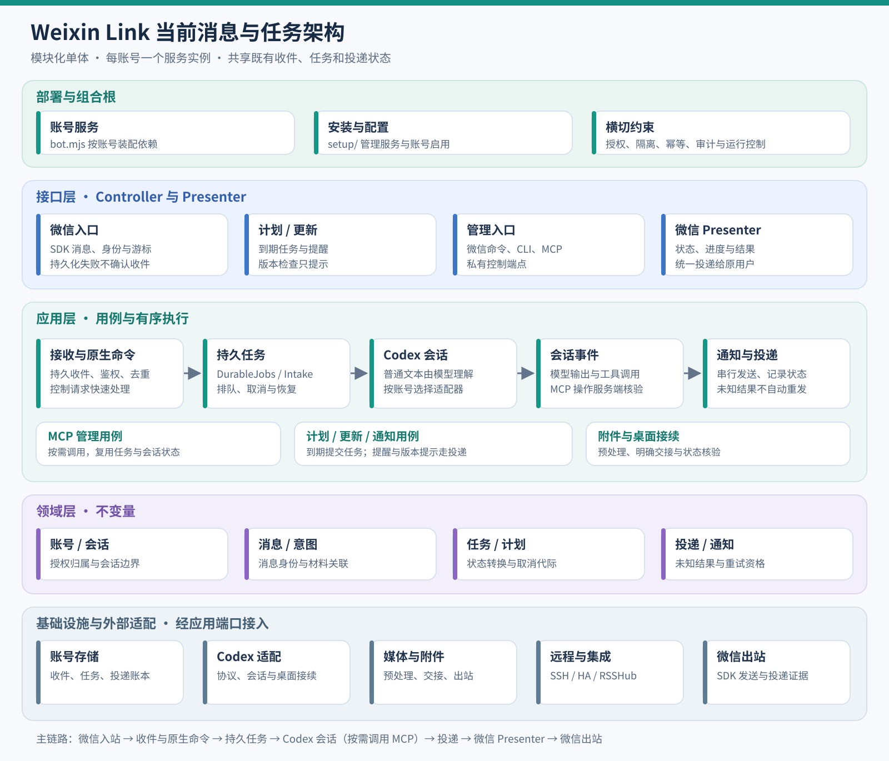

# 消息进入与执行架构

本项目是按微信账号装配的模块化单体。`src/wechat/bot.mjs` 是组合根；微信、Codex、Claude Code、WorkBuddy、Doubao、Grok 和可选集成是外部系统。新增能力先确定所属层和状态来源，再通过端口接入，避免在入口重复实现业务规则。

图展示当前主要模块与消息路径；专项规则以下文链接为准。

## 模块边界

| 位置 | 职责 | 典型入口 |
| --- | --- | --- |
| `src/interfaces/` | 接收微信、计划、更新和管理触发；解析外部格式；呈现状态与结果 | `controllers/`、`views/wechat-presenter.mjs`、`wechat/` |
| `src/application/` | 收件与意图分流、持久任务、会话与投递、远程任务、计划、通知和诊断用例；定义外部端口 | `intake/`、`tasks/`、`conversations/`、`ports/` |
| `src/domain/` | 授权归属、消息身份、任务状态、取消代际、投递与计划等规则 | `conversations/`、`messages/`、`tasks/`、`delivery/` |
| `src/infrastructure/` | 适配微信、Codex、媒体、存储、SSH 和私有运行端点 | `wechat/`、`agents/`、`media/`、`storage/`、`remote/` |
| `src/integrations/` | 按账号启用的可选集成 | 各自模块 |
| `src/setup/`、`src/wechat/` | 安装、配置、服务入口、账号档案及组合根 | `src/setup/service-entry.mjs`、`src/wechat/bot.mjs` |

普通运行模块的静态依赖按 `domain → infrastructure → application → integrations → setup → interfaces → wechat` 收敛；箭头表示更上层可以依赖更左侧模块，也允许跳过中间层。跨层协作优先使用应用层端口和组合根注入。领域层不读取微信原始字段或直接执行 I/O。`tests/domain/layer-dependencies.test.mjs` 检查跨层引用与循环。

`src/setup/service-entry.mjs` 是独立的 Windows 服务进程入口，用于启动 `wechat/bot.mjs`，不是供其他模块复用的库。账号目录保存收件、任务与投递状态；智能体适配保留各自会话状态。不为新功能建立第二套账本。

## 消息主链路

1. 微信入口 Controller 解析 SDK 消息并校验账号。轮询游标推进前，应用用例保存需排队的原消息和会话状态；保存失败则不确认收件。授权消息缺少 `message_id` 和 `client_id` 时拒绝整批，不生成临时身份。
2. `src/application/intake/` 识别明确的原生命令并处理控制分流；普通消息由 `DurableJobs` 和 `DurableIntake` 去重、排队与恢复。
3. 当前账号的 `SessionManager` 将普通文本交给逻辑对话当前选择的智能体理解。会话按需通过管理 MCP 查询状态、切换项目或派发跨项目任务；服务端重新核验会话、目标与授权，并复用原任务队列。队列记录保留底座归属，切换底座不会改派旧任务。
4. 智能体事件进入会话和投递用例，由微信 Presenter 格式化，再经串行出站适配发送。发送结果不明时保留可核对状态，不自动重发。

收件、入队与游标确认的顺序，以及重放去重、会话归属和未知投递结果，是修改链路时必须保留的语义。`message-application.mjs` 负责分流、权限、回执和任务提交；安装、切换与升级的执行交给管理模块，不在此处添加供应商协议分支。

## 其他入口与扩展

- 计划 Controller 将到期任务交给共享持久队列，将提醒交给 Presenter；计划时间规则在 `src/domain/schedules/`。
- 更新 Controller 只触发检查；版本比较、提示去重和投递恢复由领域与通知用例处理，不自动升级。
- 管理 Controller 接入安装、配置与切换。自然语言管理入口经 MCP、私有控制端点和应用管理门面复用现有会话与任务用例，见[管理 MCP](../features/management-mcp.md)。
- 未绑定的会话在原队列保留请求，由用户选择可用执行器。已绑定会话的跨项目任务由当前智能体按需调用管理 MCP，沿用管理门面、`DurableJobs` 和 `DurableIntake`；同项目顺序执行，结果返回原微信用户。任务标题只用于展示，不作为授权或去重身份。操作与附件交接规则见[统一入口](../features/unified-entry.md)。
- SSH 远端操作由本机 Codex 通过已启用集成发起；远端不运行 Codex，也不维护另一套任务账本。断线后写操作的结果保持不确定。
- 桌面接续复用管理用例与会话状态，默认关闭；见[桌面接续边界](../features/codex-desktop-handoff.md)。

权限、账号隔离、幂等、取消和运行控制贯穿这些入口。新增入口应复用对应应用用例与状态来源。

## 平台与智能体边界

WorkBuddy、Doubao 与 Grok 通过共享 `infrastructure/agents/acp/` 适配 ACP v1 的传输与会话生命周期；各自目录保留启动参数、环境过滤、版本检查及认证。启动发现只建立本进程的可用适配列表，不改写默认选择或各逻辑对话的 activeAgent。切换仍经管理 MCP 与既有持久队列；新底座连接失败恢复原绑定。协议及验证边界见 [Doubao / Grok 接入](../features/doubao-grok.md)。

平台项目保存在账号状态 `platformProjects[owner]`，逻辑对话通过 `platformProjectId` 关联。原生项目 ID 是可选链接，不是平台身份；原生会话通过 `nativeSessions` 关联。默认项目列表、项目创建/改名、逻辑会话创建、近期历史与转交不请求 Codex。只有显式原生操作或连接 Codex 执行器时才使用其协议。`list_projects.projects` 与 `projectId` 保留旧的逻辑会话编号；`platformProjects` 与 `platformProjectId` 是独立项目身份。

旧项目仅按已有原生 ID 的精确关联迁移，不按目录名、标题或相似度合并。缺少已核实目录证据的旧关联标记 `workspaceVerified=false`，禁止派发到该边界；明确确认时用 `request_project_workspace` 和已有目录凭据登记。此操作不移动目录。已有 Codex/Claude 历史数据根不自动合并。

执行、业务结果与投递是不同状态。`execution` 来自结构化轮次事件；`taskOutcome` 来自身份匹配的持久任务控制或转交回执；`delivery` 来自出站记录。`turn/completed` 不单独证明业务任务完成。没有业务结果回执时 `taskOutcome=unknown`；智能体报告的完成标注 `outcomeEvidence=agent_report`，不是独立验收，也不证明微信收到。

等待由 `request_task_input` 登记，业务结果由 `report_task_result` 登记。两者校验所属用户、逻辑会话、持久任务、原生会话、轮次与取消代际，状态保存到现有任务 context。恢复只读取持久控制和原生协议事件，不从正文或旧 XML 标记重建状态。旧标记只做精确的展示兼容清理，不能驱动状态转换。未知状态码映射 unknown；取消请求不等于已停止；任务队列入队不等于完成。

智能体自行理解需求、规划、调用工具和验证工作。微信入口仅保留停止/退出应急解析与已绑定的人工交互；SessionManager 不再解析普通文本中的审查、长任务、模型、压缩、分叉、快速模式或重置命令。管理操作通过 MCP 的结构化用例执行，人工会话恢复和审批回传仍保留。旧持久队列中的原生审查任务及旧压缩状态继续按原身份恢复。平台负责身份、授权、队列、双端操作权、控制状态、结果与附件归属、交接和投递。自然语言管理意图由智能体理解，再调用严格结构化工具；平台不新增基于助手正文的状态猜测或意图策略。

任务依赖只在结构化业务完成或已确认转交回执时放行。仅有轮次结束、正文声称完成或旧数据缺少业务结果时，依赖保持未确认并阻止自动启动；不根据正文补全历史结论。

底座通用错误的 message 只作为错误说明，不用于推断会话缺失、占用或替换身份；没有专用结构化原因时保留未确认。恢复失败不会自动新建替代原生会话。

### 空白会话、队列回答与历史文本

Codex `thread/start` 生成但尚未提交输入的 ID 只保留在当前连接，不写为可恢复绑定。首次提交前先把 ID 与 `nativeSessionState=submission_pending` 保存，再写 RPC；确认提交后转为 submitted。这样空白连接空闲释放或重启不会留下失效 ID；提交结果不确定时仍保留原绑定，不能自动换 ID 或重放。旧数据中已持久化但不可恢复的 ID 不按错误文案自动迁移。

结构化等待期间新输入保留在本地队列。已经交给原生队列的输入通过持久 predecessor（源任务与轮次）对接等待，再保留原逻辑任务、消费对应等待投影；恢复也使用同样身份，不根据回答内容分类，不清除同一目标较新的等待。

平台历史读取完整持久文本后分页。Mac 预览仍保留原有 6000/24000 字符窗口；预览截断不再传播到历史接口。近期记录保留范围不变。
