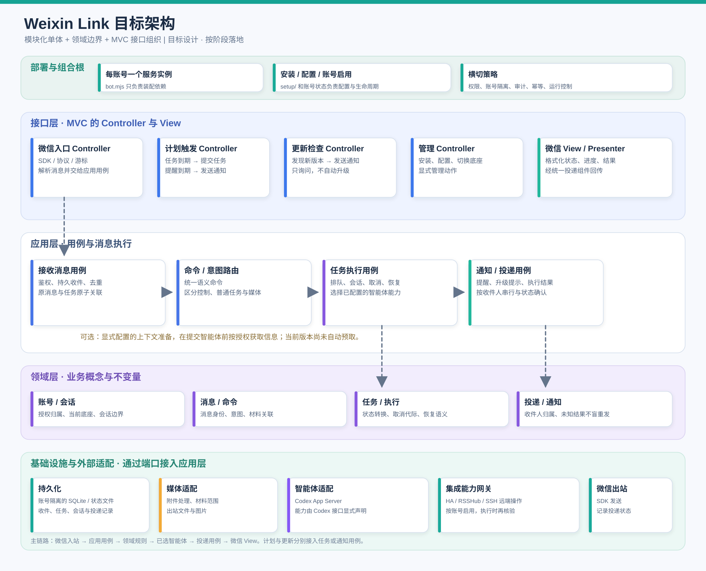

# 消息进入与执行架构

本项目保持每个微信账号一个本地服务实例的模块化单体。`src/interfaces/` 按四个 Controller、微信 Presenter 和结构化 CLI 组织；`src/infrastructure/` 提供外部边界；收件、会话、任务执行与恢复、远程任务、计划和通知用例位于 `src/application/`。会话、消息、任务、投递、计划和版本的不变量位于 `src/domain/`；`src/core/` 只保留旧命令路径的兼容入口。DDD 用于划清职责，不引入第二套状态仓库或空壳聚合。

## 当前落地边界

| 职责 | 实现位置 | 规则 |
| --- | --- | --- |
| 组合根 | `src/wechat/bot.mjs` | 为本账号装配依赖，不再重复写命令判定或 SDK 入站流程 |
| 微信入口 Controller | `src/interfaces/controllers/wechat-controller.mjs` | SDK 消息解析、账号过滤与游标前钩子；查重、设置指令冻结、控制分流、收件保存和队列捕获交给应用用例，失败不能确认收件 |
| 计划触发 Controller | `src/interfaces/controllers/schedule-controller.mjs` | 接入计划 API 与到期检查；请求授权和任务归属由应用层处理，提醒走 Presenter，任务走共享持久队列 |
| 更新检查 Controller | `src/interfaces/controllers/update-controller.mjs` | 接入定时检查；版本比较、提示去重及未知投递状态由应用层 `UpdateNotifier` 持有 |
| 管理 Controller | `src/interfaces/controllers/management-controller.mjs` | 接入微信安装、切换、升级命令与配置 CLI 参数；执行委托原管理和配置模块 |
| 命令意图 | `src/application/intake/message-intent.mjs` + `src/wechat/command-classifier.mjs` | 纯意图决策与微信命令解析分开；重放时按同一规则重新判定，不另存意图状态 |
| 消息应用处理 | `src/application/intake/receive-message.mjs`、`message-application.mjs`、`src/application/tasks/durable-intake.mjs` | 游标前保存后入队；控制命令立即处理；普通任务经持久队列逐会话执行、恢复和取消 |
| 会话与远程任务协调 | `src/application/conversations/`、`tasks/local-recovery.mjs`、`tasks/remote-recovery.mjs`、`remote-tasks/` | 沿用原会话状态、任务账本和锁；未知提交先对账，停止只作用于本会话任务 |
| 附件消息 | `src/interfaces/wechat/voice-text.mjs`、`src/application/intake/single-media.mjs`、`src/infrastructure/media/` | 接口层提取微信转写和消息 ID；应用层提交单条附件任务；基础设施层下载、解析和交付文件 |
| 领域规则 | `src/domain/conversations/`、`messages/`、`tasks/`、`delivery/`、`schedules/`、`updates/` | 以归一化的会话归属、外部消息 ID、已确认拒绝证据判断状态；不读取微信原始字段或 API 错误码，不直接执行 I/O |
| 会话与底座 | `src/base/codex/codex-session.mjs`、`src/infrastructure/agents/` | 共享会话管理与远程 RPC 适配；账号启动时选择底座，新会话的底座就绪检查不进入消息应用处理 |
| 微信 View / Presenter | `src/interfaces/views/wechat-presenter.mjs`、`src/infrastructure/media/outbound-media.mjs` | 普通任务、控制回复、计划提醒和更新通知共用会话投递入口；映射收件人、格式化通知并串行发送；结果不明时保留状态 |
| 基础设施端口 | `src/application/ports/infrastructure-ports.mjs`、`src/infrastructure/ports.mjs`、`src/infrastructure/storage/`、`src/infrastructure/updates/` | 组合根注入协议、底座、媒体等能力；计划与更新用例通过存储及版本查询适配器执行外部操作，不复制状态 |

`message-application.mjs` 负责意图分流、权限、回执和任务提交；安装、切换与升级的具体执行委托给管理模块。调用方直接导入所属模块；旧 `src/core/` 命令路径转发到 `src/interfaces/cli/`。后续扩展应继续按职责拆分，不在此文件新增供应商协议分支。图中“显式配置的上下文准备”是预留用例，当前集成不会自动预取外部信息。

## 与消息链路相连的其他能力

- `src/application/schedules/`：计划用例管理到期状态，注入的 `src/infrastructure/storage/schedule-state.mjs` 保存计划；到期任务提交到既有队列，提醒通过微信 Presenter 投递。时间规则位于 `src/domain/schedules/`。
- `src/application/notifications/`：版本提示和失败终答复恢复用例；通知状态与版本查询由 `src/infrastructure/` 适配，版本比较与重试资格位于 `src/domain/`。更新 Controller 只触发检查，不自动升级。
- `src/setup/`：安装、账号启用和配置属于组合与管理边界，不是消息执行旁路。
- `src/integrations/`：按账号启用，运行时重新核验；本机智能体按需调用。SSH 远程 Codex 是此类集成和 `src/application/remote-tasks/` 的协作，不是消息处理器里的另一个智能体底座。
- 权限、账号隔离、去重、取消代际、未知投递结果和运行控制跨越上述边界，继续使用现有状态来源。

## 消息顺序

1. SDK 批次在推进轮询游标前检查消息、保存会话状态并持久化需排队的原消息；失败时向上抛错。
2. Controller 复用已解析的消息，应用用例按注入的命令解析器分流。控制命令保留现有快速通道；普通消息持久化后交给任务处理。
3. 应用处理按统一规则分流，普通任务由 `DurableJobs` 与 `DurableIntake` 去重、排队和恢复，再交给当前账号的 `SessionManager`。
4. 智能体事件经现有会话与投递状态处理，由微信 View 和串行出站适配发送。

入站确认与任务插入的事务关系、原消息 ID 去重、会话归属和未知发送结果不自动重放均为重构时必须保持的不变量。
